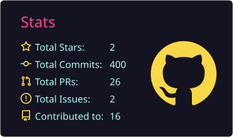
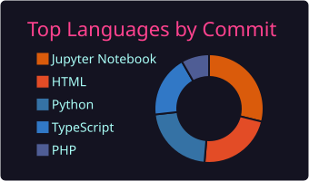

# 👋 Hi there, I'm Véronique!  
AI Engineer · Full-stack Developer
🌐 [veronique.leroux.im](https://veronique.leroux.im)

🤖 AI Engineering, What I'm Building
Currently training as an AI Engineer at OpenClassrooms, building end-to-end ML systems across the full lifecycle, from data pipelines to model deployment and evaluation.

---

## 🚀 Featured AI Projects  
♟️ Chess Openings Learning Agent (FFE use case)  
LangGraph agent that analyses a chess position and combines Lichess opening theory, Stockfish evaluation, RAG on Milvus and video suggestions to help young players prepare their openings.  
Stack: LangGraph · Stockfish · Milvus · FastAPI · Docker  
💻 [GitHub repository](https://github.com/vler0ux/ffe-chess-agent)

🩺 Medical Triage Agent (POC)  
Proof of concept of a triage assistant: fine-tuning Qwen3-1.7B-Base with SFT + LoRA, then preference alignment with DPO, on medical corpora (MediQA, FrenchMedMCQA, MedQuAD, UltraMedical-Preference). Research prototype, not intended for clinical use.  
Stack: Transformers · LoRA · SFT · DPO  
💻 [GitHub repository](https://github.com/vler0ux/p14-agent-de-triage)

🔍 Puls Events RAG  
Retrieval-Augmented Generation system for cultural events in the Grenoble area.
Stack: LangChain · Mistral AI · FAISS · RAGAS · FastAPI · MMR retriever  
💻 [GitHub repository](https://github.com/vler0ux/puls-event-rag)

📊 Home Credit MLOps  
End-to-end MLflow pipeline: XGBoost model registry, experiment tracking, artifact management & evaluation.  

🏙️ Seattle Energy & CO₂ Prediction  
Predictive modeling for 2050 carbon neutrality, feature engineering, GridSearchCV, SHAP explainability.

👗 ModeTrend Clothing Segmentation  
Semantic segmentation with SegFormer B3 via HuggingFace API, Dice/IoU metrics, validation pipeline.

## 🚀 What I Love Working On  
🔹 **Building AI systems** – RAG pipelines, LLM orchestration & evaluation  
🔹 **Full-stack development** – crafting AI-powered interfaces and APIs  
🔹 **Building business applications** to solve real-world problems  
🔹 **Exploring new technologies** and constantly improving my skill set  
🔹 **Exploring new technologies** – LLMs, computer vision, agentic systems  
🔹 **Collaborating** with teams to bring ideas to life  

---

## 🎯 My Goals  
✅ Work on diverse projects that challenge and inspire me  
✅ Keep refining my skills in **front-end & back-end** technologies  
✅ Build solutions that make a difference in people’s daily lives  
✅ Continue combining **tech and creativity** in my work  

---

## 🎵 A Bit More About Me  
🎹 **Piano lover** – music is my way to unwind and find inspiration  
📚 **Lifelong learner** – always curious to explore new tools and frameworks  
🏁 **Problem-solver** – I thrive on creating efficient and elegant solutions  

---

## 🛠️ Tech Stack  
   
     
  

### 🤖 **AI / ML**
                               

### 🖥️ **Langages**  
        

### 🗄️ **Bases de données**  
    

### ⚙️ **Outils**  
                            

---
## 📊 Statistiques  

---

## 🔥 Featured Projects  
📌 **[Portfolio](https://veronique.leroux.im)** · [source code](https://github.com/vler0ux/portfolio.git)

🏁 **RallyeMate – Business Tool** *(In Progress)*  
➜ A management tool for rally teams, handling participants, mechanics, and car maintenance.  

🌐 **WordPress Site Development** *(Completed)*  
➜ Developed and optimized WordPress websites, improving user experience and layout.  

🎮 **Webscape Animation Page** *(Completed)*  
➜ An animation page created as an add-on for the "Webscape" game, developed in collaboration with other students. It enhances the user experience with interactive features.
   
 🚍 **Public Transport DataFrame** *(Completed)*  
➜ A dataframe representing public transport routes with theoretical and real-time schedules, along with a widget to visualize the data dynamically.
  
🔴 **Laser Configuration with Arduino** *(Completed)*  
➜ A project that involved configuring a laser system using Arduino, focusing on hardware setup and programming for control and precision.  

🎵 **Educational Widget – Learn Musical Notes** *(Coming Soon)*  
➜ A fun, interactive tool to teach music notes through scrolling exercises on a staff.  

---

## 📫 Connect With Me  

  
